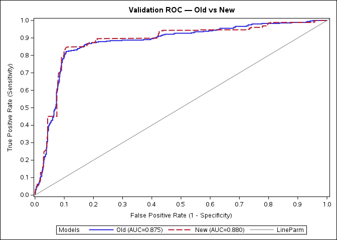
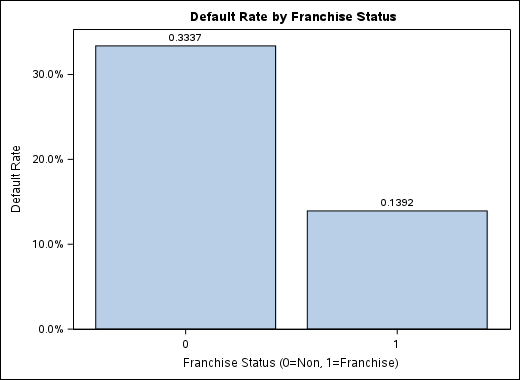
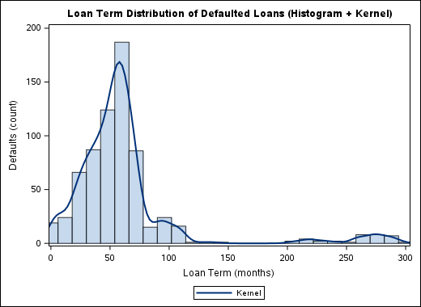

# Small Business Loan Default Model (SAS)

A credit-risk project in SAS that builds a probability-of-default (PD) model for small business loans. It covers exploratory analysis, data cleaning, logistic regression (a full model and a stepwise model), PD-to-points scaling, and validation on a hold-out sample with 10-fold cross-validation. A second part takes the model to out-of-sample (OOS) and out-of-time (OOT) loan files and checks discrimination, calibration and population stability (PSI).

This is group coursework for **BWIN621** at North-West University. The repo contains two assignments:

- **Assignment 1** (`sas/`, `data/`, `results/`, `sandbox/`): EDA, cleaning, model development, scoring and validation on the development loan file.
- **Assignment 2** (`Assignment_2/`): a data audit of the development, OOS and OOT samples, applying the Assignment 1 cleaning rules to the new samples, scoring them, and monitoring the model (ROC/AUC, KS, gains/lift, Brier score, Hosmer-Lemeshow, PSI).

## Data

| File | Rows | Notes |
|---|---|---|
| `data/raw/SmallBusinessLoans.xlsx` (sheet `LoansData`) | 2,102 | Development file, 19 columns. `Selected` = 1 marks the model-development sample and 0 the hold-out sample (1,051 loans each). |
| `Assignment_2/data/raw/SmallBusinessLoans.xlsx` | 2,102 | Same file as above. |
| `Assignment_2/data/raw/SmallBusinessLoans_OOS.xlsx` | 2,102 | Out-of-sample loans (no `Selected` or `BalanceGross` column). |
| `Assignment_2/data/raw/SmallBusinessLoans_OOT.xlsx` | 446 | Out-of-time loans (no `Selected` or `BalanceGross` column). |

- **Target:** `Default` (1 = defaulted).
- **Candidate predictors:** `Term`, `NoEmp`, `CreateJob`, `RetainedJob`, `FranchiseCode`, `UrbanRural`, `RevLineCr`, `RealEstate`, `Recession`, `DisbursementGross`, `Portion`.
- **Dropped before modelling:** identifiers and admin fields (`Name`, `LoanNr_ChkDgt`, `Zip`, `New`, `WrittenOff`, `BalanceGross`).

## Modelling pipeline

### Assignment 1: production pipeline in `sas/`

| Step | Program | What it does | Main outputs |
|---|---|---|---|
| 0. Environment | [`sas/00_env.sas`](sas/00_env.sas) | Finds the repo root from the running program's path (`&_SASPROGRAMFILE`), or from `root_override` if you set it. Creates the output folders and assigns the `RAW`, `WRK` and `RES` librefs, the `LOANS` fileref and the ODS image path. Every other program includes this file. | – |
| 1. Import | [`sas/01_import.sas`](sas/01_import.sas) | Runs `PROC IMPORT` (`DBMS=XLSX`) to load the Excel file into `RAW.LOANS`. Skips the import if `RAW.LOANS` already exists. | `data/raw/loans.sas7bdat` |
| 2. EDA | [`sas/02_eda.sas`](sas/02_eda.sas) | Default rates by area (urban/rural/undefined), recession, franchise status, loan term and disbursement, with a chi-square/Fisher test for franchise vs default, bubble charts of staffing and jobs, and correlation matrices. Uses all 2,102 loans. | `results/eda/*.png` |
| 3. Clean and split | [`sas/03_clean.sas`](sas/03_clean.sas) | Recodes `RevLineCr` to 0/1, with unknown values set to 0 (the mode). Recodes `FranchiseCode` to 0/1 (>1 = franchise). Drops the ID and admin fields. Splits on `Selected` into `WRK.DEV` (1) and `WRK.HOLD` (0), and also writes the `loans_clean_train`/`loans_clean_test` aliases. | `data/wrk/*.sas7bdat` |
| 4. Model | [`sas/04_model.sas`](sas/04_model.sas) | `PROC LOGISTIC` on `WRK.DEV` with reference-coded class variables: a **full model** with all 11 predictors and a **stepwise model** (`slentry = slstay = 0.05`). Saves both models with `OUTMODEL=` and their parameter estimates. | `results/models/logit_full_model`, `logit_step_model`, `full_params`, `step_params`; `data/wrk/dev_full_scored`, `dev_step_scored` |
| 5. Score | [`sas/05_score.sas`](sas/05_score.sas) | Scores `WRK.HOLD` (or `WRK.DEV` if there is no hold-out) with both saved models and computes `PD_full`, `PD_step` and `PD_diff`. Converts PDs to scorecard points (600 points at 50:1 good:bad odds, 20 points to double the odds, PDs clipped to avoid infinities). Prints confusion matrices and accuracy, sensitivity, specificity, F1, MCC and related metrics at a 0.5 cut-off. | `results/score/hold_scored.sas7bdat` |
| 6. Validate | [`sas/06_validation.sas`](sas/06_validation.sas) | Scores the hold-out with both models (`OUTROC=`), picks a Youden-J cut-off, and computes AUC by the trapezoid rule and misclassification error at 0.5 and at the Youden cut-off. Runs 10-fold cross-validation on `WRK.DEV` (`PROC SURVEYSELECT`, seed 271828), refitting both models in each fold. Saves an ROC overlay plot and prints coefficients and confusion matrices. "Old" = full model, "New" = stepwise model. | `results/validation/*.sas7bdat`, `results/validation/plots/ROC_Validation_Overlay.png` |
| Driver | [`sas/99_driver.sas`](sas/99_driver.sas) | Runs the whole pipeline: import (if needed), then clean, EDA, model, score and validate. | – |

### Assignment 2: OOS/OOT monitoring in `Assignment_2/sandbox/`

| Step | Program | What it does |
|---|---|---|
| 1. Import and audit | [`Tafara Kanyemba/import.sas`](Assignment_2/sandbox/Tafara%20Kanyemba/import.sas) | Imports the DEV, OOS and OOT Excel files into `sasdata/*_raw` and adds `bad_flag`. Reports record counts, default rates, a data dictionary and missing-value checks. Compares average jobs created and retained across the samples as an indicator of economic conditions, and exports the tables to `output/tables/`. |
| 2. Parity prep | [`Tafara Kanyemba/cleaning.sas`](Assignment_2/sandbox/Tafara%20Kanyemba/cleaning.sas) | Applies the Assignment 1 cleaning rules to OOS and OOT, producing `sasdata/oos_prep` and `oot_prep`. |
| 3. Score and monitor | [`Tapiwa Gweshe/Scoring.sas`](Assignment_2/sandbox/Tapiwa%20Gweshe/Scoring.sas) | Refits the stepwise model on the development sample with `LACKFIT` (Hosmer-Lemeshow) and standardised estimates, and saves the ROC association, ROC curve, parameters and HL partition. Scores `oos_prep`/`oot_prep` to get `pd_hat` and a clipped logit. Macros compute the Brier score, decile tables and plots (average PD vs bad rate), ROC/AUC from the scores, KS, gains/lift, and PSI on `pd_hat` (10 equal-width PD bins, OOS expected vs OOT actual). Exports PNGs, `Model_Report.xlsx` and CSVs. |
| Hosmer-Lemeshow | [`Tlangelani Motloung/TT_HL.sas`](Assignment_2/sandbox/Tlangelani%20Motloung/TT_HL.sas) | Standalone program: refits the stepwise model with the `LACKFIT` HL test and scores the hold-out (`Selected=0`). |
| PSI | [`Tlangelani Motloung/TT_PSI.sas`](Assignment_2/sandbox/Tlangelani%20Motloung/TT_PSI.sas) | Standalone program: refits the stepwise model, scores OOS and OOT, bins PDs into 10 equal-width bins and computes PSI. |

`Assignment_2/sasdata/` also holds calibrated scores (`scored_oos_cal`, `scored_oot_cal`, with `lin_cal`/`pd_cal` columns), and `Assignment_2/output/tables/` holds numbered audit tables (`00_*` to `04_*`). The programs that produced these files are not in the repo.

## Tech stack

- SAS: Base SAS, macro language, `PROC IMPORT`, `PROC SQL`, `PROC LOGISTIC`, `PROC SURVEYSELECT`, `PROC FREQ`/`MEANS`/`CORR`, `PROC SGPLOT`/`SGPIE`, ODS Excel/HTML5
- SAS Studio on SAS Viya (the team used SAS Viya for Learners)
- Data in Excel (`.xlsx`) and SAS datasets (`.sas7bdat`)

## Project structure

```
smallloanbusiness/
├── sas/                         Assignment 1 pipeline (00_env … 06_validation, 99_driver)
├── data/
│   ├── raw/                     SmallBusinessLoans.xlsx and imported RAW.LOANS
│   └── wrk/                     cleaned and split datasets (DEV, HOLD, train/test aliases, scored DEV)
├── results/
│   ├── eda/                     EDA plots (PNG)
│   ├── models/                  saved PROC LOGISTIC models and parameter estimates (full_params.csv)
│   ├── score/                   scored hold-out sample
│   └── validation/              validation and 10-fold CV tables; plots/ROC_Validation_Overlay.png
├── sandbox/                     Assignment 1 drafts, one folder per team member
│   ├── Shahil Mathapershad/     Model+Validation.sas (origin of 06_validation)
│   ├── Tafara Kanyemba/         EDA.sas (origin of 02_eda)
│   ├── Tapiwa Gweshe/           Scoring.sas (origin of 05_score) and scored test data
│   ├── Tlangelani Motloung/     TT_Data_Cleaning.sas and working datasets
│   └── data/wrk/                stray empty working datasets
└── Assignment_2/
    ├── data/raw/                DEV, OOS and OOT Excel files
    ├── data/full_paramsA1.csv   copy of the Assignment 1 full-model coefficients
    ├── sasdata/                 raw imports, prepped OOS/OOT, scored and calibrated datasets
    ├── output/tables/           data-audit tables (counts, data dictionary, numeric summaries, jobs indicators)
    └── sandbox/<member>/        Assignment 2 programs and outputs, per team member
```

## Getting started

### Prerequisites

- **SAS Studio** on SAS Viya or another Linux SAS server, with SAS/STAT (`PROC LOGISTIC`, `PROC SURVEYSELECT`), ODS Graphics and `PROC IMPORT DBMS=XLSX`.
- The programs find their own folder through the SAS Studio macro variable `&_SASPROGRAMFILE` and split paths on `/`. Run them as **saved files opened from the repo folder** in SAS Studio, not from an unsaved tab or a Windows SAS session.

### 1. Get the repo onto the SAS server

Clone the repo with SAS Studio's Git integration, or upload the whole folder to your SAS Studio home directory. Keep the folder structure as it is.

### 2. Run Assignment 1

Open `sas/99_driver.sas` and click **Run**. The driver includes the other programs in this order:

```
00_env → 01_import (only if RAW.LOANS is missing) → 03_clean → 02_eda → 04_model → 05_score → 06_validation
```

You can also run the programs one at a time in the same order. Each one includes `00_env.sas` itself. `02_eda`, `03_clean` and `04_model` run their missing prerequisites automatically. `05_score` and `06_validation` stop with an error if the saved models from `04_model` are missing.

Paths and settings to check:

- **Repo root.** `00_env.sas` normally works the root out by itself. If it can't, set `%let root_override=/path/to/smallloanbusiness;` on line 9 of [`sas/00_env.sas`](sas/00_env.sas). Without the override, and when `&_SASPROGRAMFILE` is empty, it falls back to the **hard-coded** path `/export/viya/homes/&sysuserid./casuser/BWIN621_Project` (line 27).
- **Import is skipped** because `data/raw/loans.sas7bdat` is already committed. To force a fresh import from the Excel file, delete that dataset first.
- **Outputs are overwritten.** A run replaces the committed outputs in `data/` and `results/`.

### 3. Run Assignment 2

These programs use **hard-coded absolute paths** to the authors' SAS Viya home folders. Before running them, change each path to your own copy of `Assignment_2/`:

| Program | Line(s) | Setting |
|---|---|---|
| `Assignment_2/sandbox/Tafara Kanyemba/import.sas` | 7 | `%let PROJ_ROOT=…/Assignment_2;` |
| `Assignment_2/sandbox/Tafara Kanyemba/cleaning.sas` | 6 | `%let PROJ_ROOT=…/Assignment_2;` |
| `Assignment_2/sandbox/Tapiwa Gweshe/Scoring.sas` | 8, 368 | `%let A2_ROOT=…/Assignment_2;` and `%let EXPDIR=…/sandbox/Tapiwa Gweshe;` |
| `Assignment_2/sandbox/Tlangelani Motloung/TT_HL.sas` | 13 | `filename REFFILE '…/SmallBusinessLoans.xlsx';` |
| `Assignment_2/sandbox/Tlangelani Motloung/TT_PSI.sas` | 13, 45, 97 | `filename` paths to the DEV, OOS and OOT Excel files |

Run order: `import.sas`, then `cleaning.sas`, then `Scoring.sas`. `TT_HL.sas` and `TT_PSI.sas` are standalone. Re-run `import.sas` and `cleaning.sas` before `Scoring.sas` rather than relying on the committed `sasdata/*_prep` datasets: those datasets have no `UrbanRural` column, and the stepwise model needs it.

The Assignment 1 drafts in `sandbox/` (`Tafara Kanyemba/EDA.sas`, `Shahil Mathapershad/Model+Validation.sas`, `Tapiwa Gweshe/Scoring.sas`) also use hard-coded home-folder paths. The production versions of that work are in `sas/`.

## Results

### Assignment 1: hold-out validation



Values from `results/validation/perf.sas7bdat`, rounded to 3 decimals. Errors are misclassification rates on the 1,051-loan hold-out; the CV error comes from 10-fold CV on the development sample.

| Model | Error @ 0.5 | Error @ Youden cut-off | AUC (hold-out) | 10-fold CV error @ 0.5 |
|---|---|---|---|---|
| Full ("Old") | 0.159 | 0.131 | 0.875 | 0.164 |
| Stepwise ("New") | 0.156 | 0.123 | 0.880 | 0.159 |

The stepwise model keeps `Term`, `UrbanRural`, `RevLineCr` and `RealEstate` (`results/models/step_params.sas7bdat`). The full-model coefficients are in [`results/models/full_params.csv`](results/models/full_params.csv).

### Assignment 1: EDA plots (`results/eda/`)

| File | Plot |
|---|---|
| `SGPie.png`, `SGPie1.png`, `SGPie2.png` | Default vs non-default share, for urban, rural and undefined areas |
| `SGPie3.png`, `SGPie4.png`, `SGPie5.png` | The same split for loans issued in a recession |
| `SGPlot.png` | Default rate by franchise status |
| `SGPlot1.png` | Default rate by loan term (12-month bins) |
| `SGPlot2.png` | Loan-term distribution of defaulted loans (histogram and kernel density) |
| `SGPlot3.png`, `SGPlot4.png` | Employees vs jobs created, for defaulters and non-defaulters (bubble size = jobs retained) |
| `SGPlot5.png` | Mean disbursement by guaranteed portion, franchise vs non-franchise |
| `MatrixPlot.png`, `MatrixPlot1.png` | Scatter matrices for defaulted loans (NoEmp/CreateJob/RetainedJob; NoEmp/DisbursementGross) |

 

Values shown on the plots: the default share is 35.4% for urban loans, 40.9% for rural and 7.7% for undefined. For loans issued in a recession it rises to 60.9% (urban), 70.0% (rural) and 10.5% (undefined). Non-franchise businesses default at 0.3337 and franchises at 0.1392.

### Assignment 2: samples and development-model fit

From `Assignment_2/output/tables/`:

| Sample | Records (`counts_*.csv`) | Default rate | Avg jobs created (`03_avg_jobs_created.csv`) | Avg jobs retained (`04_avg_jobs_retained.csv`) |
|---|---|---|---|---|
| DEV (full development file) | 2,102 | 32.64% | 2.55 | 5.80 |
| OOS | 2,102 | 21.74% | 2.72 | 5.99 |
| OOT | 446 | 6.73% | 4.65 | 8.63 |

Outputs from `Scoring.sas` in [`Assignment_2/sandbox/Tapiwa Gweshe/`](Assignment_2/sandbox/Tapiwa%20Gweshe/):

- `dev_rocassoc.csv`: concordance on the development sample is c = 0.883 (Somers' D 0.766).
- `dev_hl.csv`: the Hosmer-Lemeshow partition table (observed vs expected events, 9 groups).
- `dev_params.csv`: the stepwise coefficients with standardised estimates.
- `Model_Report.xlsx`: these tables, plus the PSI table and PSI value.


## Notes and limitations

- **The Assignment 2 OOS/OOT results are incomplete.** `oos_scored_pp.csv` and `oot_scored_pp.csv` contain only a header row, and `psi_pd_hat.csv` is all zeros, so the committed PSI of 0 (`psi_value.csv`) is not a real result. The scored files `SCORED_OOS.csv` and `SCORED_OOT.csv` give nearly the same PD (about 0.95–1.00) to every loan, while the observed default rates are 21.7% and 6.7%. Their linear predictor only includes the intercept, `RevLineCr` and `RealEstate` terms and leaves out `Term` and `UrbanRural`. Re-run the Assignment 2 programs in the order above before using these outputs.
- **`99_driver.sas` ends with an error.** Its final summary writes `_rawc`/`_wrkc` into the `RAW`/`WRK` libraries (so they appear in `data/`) but then prints `_raw`/`_wrk`, which don't exist. The run-id EDA subfolder it creates also stays empty, because each included program re-runs `00_env.sas`, which points the plots back to `results/eda/`.
- **`05_score.sas` only reports confusion metrics at the 0.5 cut-off.** It would also use Youden-J cut-offs, but only if `SCORE.<tag>_ROC_FULL`/`_ROC_STEP` tables exist, and no program creates them. Youden-based results come from `06_validation.sas`.
- **Some committed outputs don't match the current code.** `results/score/hold_scored.sas7bdat` comes from an earlier version of `05_score.sas`, and the files listed at the end of the Assignment 2 pipeline section have no program in the repo. Re-running the pipeline replaces the Assignment 1 outputs.
- **There are duplicate data files.** The development Excel file is committed several times, in `data/raw/`, `Assignment_2/data/raw/` and several sandbox folders.

## Team

Group members, as named in the `sandbox/` folders:

- **Shahil Mathapershad**: model comparison and validation (`06_validation.sas`)
- **Tafara Kanyemba**: EDA (`02_eda.sas`); Assignment 2 data audit and OOS/OOT preparation
- **Tapiwa Gweshe**: environment, import, scoring and driver (`00_env.sas`, `01_import.sas`, `05_score.sas`, `99_driver.sas`); Assignment 2 scoring and monitoring
- **Tlangelani Motloung**: model fitting (`04_model.sas`); Assignment 2 Hosmer-Lemeshow and PSI programs

Authorship follows the header comments in each program.
